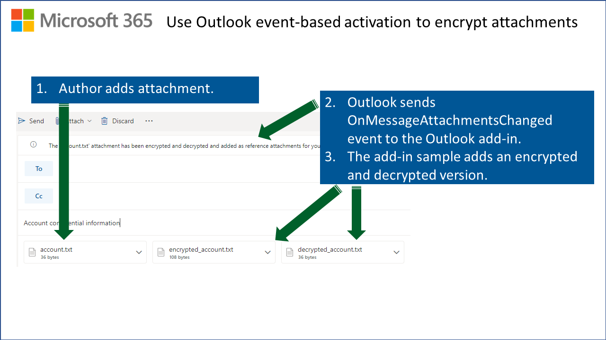
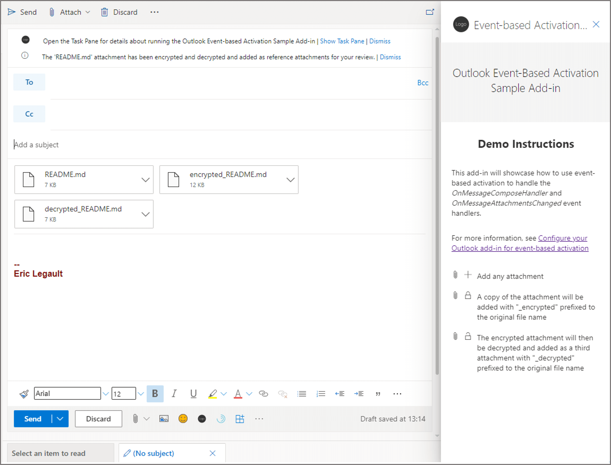
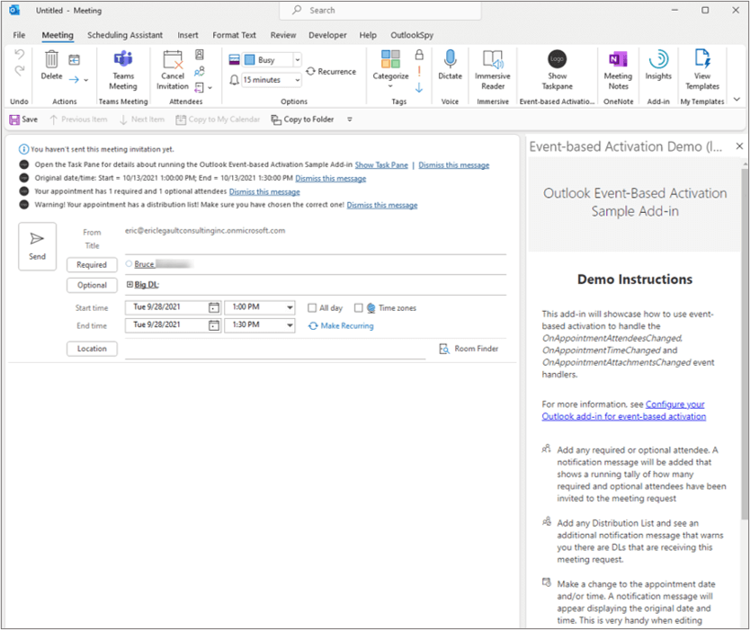

# Manage attachments and meeting details while composing in Outlook with event-based activation

**Applies to**: Outlook on Windows ([new](https://support.microsoft.com/office/656bb8d9-5a60-49b2-a98b-ba7822bc7627) and classic) | Outlook on the web | Outlook on Mac



## Summary

This sample showcases how to use event-based activation in an Outlook add-in to run operations when the user:

- Composes an message or meeting request.
- Adds an attachment to an message or meeting request.
- Adds recipients or distributions lists as required or optional attendees to a meeting request.
- Changes the start date, end date, or time in a meeting request.

To learn more about event-based activation, see [Activate add-ins with events](https://learn.microsoft.com/office/dev/add-ins/develop/event-based-activation).

## Features

- **Encryption based on attachment additions.** This sample encrypts the first attachment added to a composed message or meeting, and adds it as another attachment with an "encrypted_" prefix on the file name. It then decrypts that attachment and adds it as another attachment with a "decrypted_" prefix on the file name.

  It also adds a notification message to the compose item to denote that encryption and decryption is in progress. When completed, that message is removed (it may only appear for a very brief time, depending on the complexity of the encryption process) and another notification message is added noting that the process has completed.

  

  > [!NOTE]
  > For demonstration purposes, this sample uses a repeating-key XOR transformation with a hard-coded demonstration key for attachment processing. It's reversible obfuscation, not a secure encryption protocol. Don't use it in a production add-in.

- **Notifications based on recipient changes.** This sample adds notification messages to a meeting request when recipients are added or removed. The notification message are removed when there are no longer any recipients.
  - Shows a notification with a running tally of the number of required and optional attendees.
  - Shows a notification with a warning if one or more distribution lists are added as an attendee.

- **Notifications based on date or time changes.** This sample adds a notification message to a meeting when the user changes the date or time, showing the original date or time that was set when the meeting was created. The notification message provides a reference for further edits.

  

## Applies to

- Outlook
  - Windows (new and classic)
  - web browser
  - Mac

## Prerequisites

- Microsoft 365

  > Note: If you don't have a Microsoft 365 subscription, you can get a [free developer sandbox](https://developer.microsoft.com/microsoft-365/dev-program#Subscription) that provides a renewable 90-day Microsoft 365 E5 subscription for development purposes.

- To run on localhost, install a current LTS version of [Node.js](https://nodejs.org/) and [npm](https://www.npmjs.com/get-npm).
- To use the unified manifest for Microsoft 365, use a supported Microsoft 365 version of Outlook on Windows (new or classic) or on the web. See [Office Add-ins with the unified app manifest for Microsoft 365](https://learn.microsoft.com/office/dev/add-ins/develop/unified-manifest-overview) for client and account requirements.

## Choose a manifest type

The sample uses the unified manifest for Microsoft 365 by default. You can switch the project between the unified manifest and the add-in only manifest. Both manifest types use the same source files, **package.json**, **package-lock.json**, and **webpack.config.js**. To continue with the unified manifest, skip ahead to [run the sample using localhost](#use-localhost).

> [!NOTE]
> To run the sample in Outlook on Mac, use the add-in only manifest. For more information on manifests and their supported platforms, see [Office Add-in manifest](https://learn.microsoft.com/office/dev/add-ins/develop/add-in-manifests). For information about events and their supported platforms, see [Activate add-ins with events](https://learn.microsoft.com/office/dev/add-ins/develop/event-based-activation#supported-events).

### To switch to the add-in only manifest

Copy all files from [manifest-configurations/add-in-only](./manifest-configurations/add-in-only) to the sample's root folder and remove **manifest.json** from the root folder. The **manifest-localhost.xml** file points to [locally hosted web files](#use-localhost), while **manifest.xml** points to [GitHub-hosted web files](#use-github).

### To switch back to the unified manifest for Microsoft 365

Copy [manifest-configurations/unified/manifest.json](./manifest-configurations/unified/manifest.json) to the sample's root folder. Remove **manifest.xml** and **manifest-localhost.xml** from the root folder.

## Run the sample

For this sample, the unified manifest supports only [localhost](#use-localhost). With the add-in only manifest, you can use either localhost or [GitHub-hosted web files](#use-github).

### Use localhost

1. Clone or download this repository.
1. From a terminal, go to **Samples/outlook-encrypt-attachments**.
1. Run the following command to install the dependencies.

    ```console
    npm install
    ```

1. Run the command for your manifest type to start the HTTPS development server at `https://localhost:3000` and sideload the add-in.

    **Unified manifest for Microsoft 365**

    ```console
    npm start
    ```

    **Add-in only manifest**

    ```console
    npm run start:xml
    ```

    On first run, accept the prompt to trust the Office Add-in development certificate. If prompted, sign in with your Microsoft 365 account to sideload the unified manifest.

1. Follow the steps in [Try it out](#try-it-out).
1. To stop the server and uninstall the add-in, run the command for your manifest type.

    **Unified manifest for Microsoft 365**

    ```console
    npm stop
    ```

    **Add-in only manifest**

    ```console
    npm run stop:xml
    ```

### Use GitHub

This option uses the add-in only manifest (**manifest.xml**). The web files are served from this repository on GitHub, so source changes on your computer won't affect the running add-in.

1. Download **manifest.xml** to a folder on your computer.
1. Sideload the add-in manifest by following the manual instructions in [Sideload Outlook add-ins for testing](https://learn.microsoft.com/office/dev/add-ins/outlook/sideload-outlook-add-ins-for-testing).
1. Follow the steps in [Try it out](#try-it-out).
1. To uninstall the add-in, see [Remove a sideloaded add-in](https://learn.microsoft.com/office/dev/add-ins/outlook/sideload-outlook-add-ins-for-testing?tabs=xmlmanifest#remove-a-sideloaded-add-in).

### Try it out

Once the add-in is loaded, use the following steps to try out the functionality.

#### Create a new message or meeting

1. Create a new message or meeting in Outlook.

    > A notification appears that reads **Learn how to run the Outlook Event-based Activation Sample Add-in**. It contains options to **Show task pane** and **Dismiss** the notification.

1. Choose **Show task pane** from the notification to open the sample's instructions and reference information. You can also choose **Show task pane** from the ribbon.

#### Manage an attachment

In a new message or appointment, attach a local file of any type whose name doesn't start with `encrypted_` or `decrypted_`. Cloud attachments aren't supported. In Outlook on the web and the new Outlook on Windows, the **Upload to OneDrive** attachment option isn't supported.

> Encrypted and decrypted copies of the attachment are added, with file names prefixed with `encrypted_` and `decrypted_`, respectively. The original attachment remains. A notification appears that reads **The '{file name} attachment has been encrypted and decrypted and added as reference attachments for your review.**

> [!NOTE]
> The sample processes only the first attachment added during the item's compose session. Adding another attachment after successful processing doesn't create more copies. The transformation uses demonstration-only XOR obfuscation, not secure encryption; the original and decrypted copies remain unprotected.

#### Set up a meeting

1. Create a new meeting request.

    > A notification appears that reads **Learn how to run the Outlook Event-based Activation Sample Add-in**. It contains options to **Show task pane** and **Dismiss** the notification.

1. Add a user as a required or optional attendee.

    > A notification appears providing a tally of required and optional attendees.

1. Add a distribution list as a required or optional attendee.

    > A notification appears that reads **Warning: Your appointment has a distribution list. Make sure you have chosen the correct group.**

1. Change the start or end date or time.

    > A notification appears specifying the previous start and end dates and times.

## Key parts of this sample

### Configure event-based activation in the manifest

Both manifest types configure the same six events, using different event names. For more information about each event, see [Outlook events](https://learn.microsoft.com/office/dev/add-ins/develop/event-based-activation#outlook-events).

| Add-in only manifest | Unified manifest |
| --- | --- |
| `OnNewMessageCompose` | `newMessageComposeCreated` |
| `OnNewAppointmentOrganizer` | `newAppointmentOrganizerCreated` |
| `OnAppointmentAttendeesChanged` | `appointmentAttendeesChanged` |
| `OnAppointmentTimeChanged` | `appointmentTimeChanged` |
| `OnMessageAttachmentsChanged` | `messageAttachmentsChanged` |
| `OnAppointmentAttachmentsChanged` | `appointmentAttachmentsChanged` |

The unified manifest uses `extensions.runtimes` to specify the code for event-based activation.

- Outlook on the web and new Outlook on Windows use `code.page` to load the HTML page, which loads the event handler JavaScript file.
- Classic Outlook on Windows uses `code.script` to load the event handler JavaScript file directly in a JavaScript-only runtime, without loading the HTML page.

The `extensions.autoRunEvents` property maps events to actions. For example, the following runtime defines an action for the new-message compose event.

```json
{
  "id": "event_runtime",
  "type": "general",
  "code": {
    "page": "https://localhost:3000/commands/commands.html",
    "script": "https://localhost:3000/commands/commands.js"
  },
  "lifetime": "short",
  "actions": [
    { "id": "onMessageComposeHandler", "type": "executeFunction" }
  ]
}
```

The unified manifest also defines separate task pane runtimes and ribbon controls for message compose and appointment organizer surfaces. The control IDs match the `commandId` values used by the notification messages.

In the add-in only manifest, the following `<Runtime>` element specifies a `commands.html` page resource ID that loads the `commands.js` file in Outlook on the web, on Mac, and new Outlook on Windows. The `<Override>` element directly specifies the `commands.js` JavaScript file to load when running on classic Outlook on Windows. Classic Outlook on Windows doesn't use the HTML page to load the JavaScript file.

```xml
<Runtime resid="WebViewRuntime.Url">
  <Override type="javascript" resid="JSRuntime.Url"/>
...
<bt:Url id="WebViewRuntime.Url" DefaultValue="https://officedev.github.io/Office-Add-in-samples/Samples/outlook-encrypt-attachments/src/commands/commands.html" />
<bt:Url id="JSRuntime.Url" DefaultValue="https://officedev.github.io/Office-Add-in-samples/Samples/outlook-encrypt-attachments/src/commands/commands.js" />
```

The add-in handles six events that are mapped to various functions.

```xml
<LaunchEvents>
  <LaunchEvent Type="OnNewMessageCompose" FunctionName="onMessageComposeHandler" />
  <LaunchEvent Type="OnNewAppointmentOrganizer" FunctionName="onAppointmentComposeHandler" />
  <LaunchEvent Type="OnAppointmentAttendeesChanged" FunctionName="onAppointmentAttendeesChangedHandler" />
  <LaunchEvent Type="OnAppointmentTimeChanged" FunctionName="onAppointmentTimeChangedHandler" />
  <LaunchEvent Type="OnMessageAttachmentsChanged" FunctionName="onMessageAttachmentsChangedHandler" />
  <LaunchEvent Type="OnAppointmentAttachmentsChanged" FunctionName="onAppointmentAttachmentsChangedHandler" />
</LaunchEvents>
```

### Handle events

When the user creates a new message or appointment, Outlook loads the `commands.js` file specified in the manifest to handle the following events.

| Event | Handler |
| --- | --- |
| `OnNewMessageCompose` | `onMessageComposeHandler` |
| `OnNewAppointmentOrganizer` | `onAppointmentComposeHandler` |
| `OnAppointmentAttendeesChanged` | `onAppointmentAttendeesChangedHandler` |
| `OnAppointmentTimeChanged` | `onAppointmentTimeChangedHandler` |
| `OnMessageAttachmentsChanged` | `onItemAttachmentsChangedHandler` |
| `OnAppointmentAttachmentsChanged` | `onItemAttachmentsChangedHandler` |

Each event handler must be registered in `commands.js` with `Office.actions.associate` to map the manifest action to its JavaScript implementation. The first argument must match the action ID in the unified manifest or the `FunctionName` in the add-in only manifest. The second argument is the handler function. For example, `Office.actions.associate("onMessageAttachmentsChangedHandler", onItemAttachmentsChangedHandler);`.

### Attachment transformation

The attachment event handler transforms the decoded file bytes with XOR, attaches the result using `addFileAttachmentFromBase64Async`, applies the same transformation again, and attaches the restored bytes.

The sample attempts only the first attachment added during the item's compose session, recording that attempt in `sessionData` so subsequent event activations don't repeat it. A processing failure displays an Outlook error notification and releases the session marker so another attachment can be tried. Files with `encrypted_` or `decrypted_` prefixes are skipped to avoid processing the generated copies.

## Solution

| Solution | Authors |
| ---- | ---- |
| Use Outlook event-based activation to process item attachments, meeting request recipients, and meeting date and time changes. | [Eric Legault](https://twitter.com/elegault) |

## Version history

| Version | Date       | Comments        |
| ------- | ---------- | --------------- |
| 1.0     | October 14, 2021 | Initial release. |
| 1.1 | September 10, 2026 | Updated the Office.js CDN URL. |
| 2.0 | October 27, 2026 | Added a unified manifest for Microsoft 365 and updated the encryption protocol. |

## References

- [Activate add-ins with events](https://learn.microsoft.com/office/dev/add-ins/develop/event-based-activation)
- [Debug event-based or spam-reporting add-ins](https://learn.microsoft.com/office/dev/add-ins/outlook/debug-autolaunch)
- [Create notifications for your Outlook add-in](https://learn.microsoft.com/office/dev/add-ins/outlook/notifications)

## Questions and feedback

- Did you experience any problems with the sample? [Create an issue](https://github.com/OfficeDev/Office-Add-in-samples/issues/new/choose) and we'll help you out.
- We'd love to get your feedback about this sample. Go to our [Office samples survey](https://aka.ms/OfficeSamplesSurvey) to give feedback and suggest improvements.
- For general questions about developing Office Add-ins, go to [Microsoft Q&A](https://learn.microsoft.com/answers/topics/office-js-dev.html) using the office-js-dev tag.

## Copyright

Copyright (c) 2021 Microsoft Corporation. All rights reserved.

This project has adopted the [Microsoft Open Source Code of Conduct](https://opensource.microsoft.com/codeofconduct/). For more information, see the [Code of Conduct FAQ](https://opensource.microsoft.com/codeofconduct/faq/) or contact [opencode@microsoft.com](mailto:opencode@microsoft.com) with any additional questions or comments.

---


