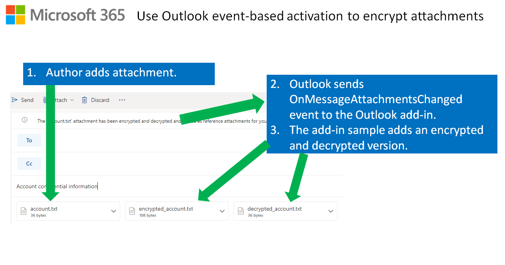

# Identify and tag external recipients using Outlook event-based activation

**Applies to**: Outlook on the web | Outlook on Windows ([new](https://support.microsoft.com/office/656bb8d9-5a60-49b2-a98b-ba7822bc7627) and classic) | Outlook on Mac

## Summary

This sample uses event-based activation to run an Outlook add-in when the user changes recipients while composing a message. If external recipients are added, the add-in prepends "[External]" to the message subject and uses the [notificationMessages](https://learn.microsoft.com/office/dev/add-ins/outlook/notifications) API to display an informational notification to the sender.



For documentation related to this sample, see [Activate add-ins with events](https://learn.microsoft.com/office/dev/add-ins/develop/event-based-activation).

## Features

- Use event-based activation to respond to changes in the **To**, **Cc**, and **Bcc** fields during compose mode, including replies and forwards.
- Update the message subject to indicate there are external recipients.
- Display a persistent informational notification to the sender without changing the message body or duplicating the notification.
- Remove the subject tag and notification when no external recipients remain.

## Applies to

- Outlook
  - Web
  - Windows (new and classic)
  - Mac

## Prerequisites

- Microsoft 365

    > **Note**: If you don't have a Microsoft 365 subscription, you might qualify for a Microsoft 365 E5 developer subscription for development purposes through the [Microsoft 365 Developer Program](https://aka.ms/m365devprogram); for details, see the [FAQ](https://learn.microsoft.com/office/developer-program/microsoft-365-developer-program-faq#who-qualifies-for-a-microsoft-365-e5-developer-subscription-). Alternatively, you can [sign up for a 1-month free trial](https://www.microsoft.com/microsoft-365/try) or [purchase a Microsoft 365 plan](https://www.microsoft.com/microsoft-365/business/compare-all-microsoft-365-business-products-g).

- To run the sample on localhost, install a recent version of [Node.js](https://nodejs.org) and [npm](https://www.npmjs.com/get-npm). To check if you already have these tools installed, run `node -v` and `npm -v` from a command prompt.

## Solution

| Solution | Authors |
|---------|----------|
| Use Outlook event-based activation to tag a message with external recipients | Microsoft |

## Version history

| Version | Date | Comments |
|---------|------|---------|
| 1.0 | July 6, 2021 | Initial release. |
| 1.1 | November 1, 2021 | Updated for GA of SessionData API and OnMessageRecipientsChanged event. |
| 1.2 | September 10, 2026 | Updated the Office.js CDN URL. |
| 2.0 | October 23, 2026 | Use the unified manifest for Microsoft 365 by default and update sample functionality. |

----------

## Scenario: Event-based activation

In this scenario, if the message has external recipients, the add-in prepends "[External]" to the message subject and displays "This email includes external recipients. Please review all recipients before sending." above the message body. When all external recipients are removed, the add-in removes the subject tag and its notification.

## Choose a manifest type

By default, the sample uses the unified manifest for Microsoft 365. However, you can switch the project between the unified manifest and the add-in only manifest. For more information about the differences between them, see [Office Add-ins manifest](https://learn.microsoft.com/office/dev/add-ins/develop/add-in-manifests). To continue with the unified manifest, skip ahead to the [Run the sample](#run-the-sample) section.

> [!NOTE]
> To run the sample in Outlook on Mac, use the add-in only manifest. For more information on manifests and their supported platforms, see [Office Add-in manifest](https://learn.microsoft.com/office/dev/add-ins/develop/add-in-manifests). For information about events and their supported platforms, see [Activate add-ins with events](https://learn.microsoft.com/office/dev/add-ins/develop/event-based-activation#supported-events).

### To switch to the add-in only manifest

Copy all the files from the [manifest-configurations/add-in-only](./manifest-configurations/add-in-only) subfolder to the sample's root folder, replacing any existing files that have the same names. We recommend that you delete the **manifest.json** file from the root folder. Then, [run the sample](#run-the-sample) using the add-in only manifest instructions.

### To switch back to the unified manifest for Microsoft 365

To switch back to the unified manifest, copy all the files from the [manifest-configurations/unified](./manifest-configurations/unified) subfolder to the sample's root folder, replacing any existing files that have the same names. We recommend that you delete the **manifest.xml** and **manifest-localhost.xml** files from the root folder, so only files needed for the unified manifest are present. Then, [run the sample on localhost](#use-localhost).

Both manifest types use the same **package.json**, **package-lock.json**, and **webpack.config.js** files in the sample's root folder.

## Run the sample

To run the sample, choose whether to host the add-in's web files on [localhost](#use-localhost) or on [GitHub](#use-github).

### Use localhost

1. Clone or download this repository.
1. From a command prompt, go to the root of the project folder **Samples/outlook-tag-external**.
1. Run `npm install`.
1. Start the development server and sideload the manifest using the instructions for your chosen manifest.

    **Unified manifest for Microsoft 365 (default)**

    ```console
    npm start
    ```

    **Add-in only manifest (after switching manifest types)**

    ```console
    npm run start:xml
    ```

    The XML command uses **manifest-localhost.xml**. The **manifest.xml** file is for the [GitHub-hosted option](#use-github).

1. Follow the steps in [Try it out](#try-it-out).
1. To stop the web server and uninstall the add-in from Outlook, run the command for the manifest you used.

    **Unified manifest for Microsoft 365 (default)**

    ```console
    npm stop
    ```

    **Add-in only manifest**

    ```console
    npm run stop:xml
    ```

### Use GitHub

> [!NOTE]
> The option to use GitHub as the web host only applies to the add-in only manifest.

The quickest way to run the sample is to use GitHub as the web host. However, you can't debug or change the source code. The add-in web files are served from this GitHub repository.

1. Download [manifest.xml](./manifest-configurations/add-in-only/manifest.xml) to a folder on your computer.
1. Sideload the manifest by following the manual instructions in [Sideload Outlook add-ins for testing](https://learn.microsoft.com/office/dev/add-ins/outlook/sideload-outlook-add-ins-for-testing).
1. Follow the steps in [Try it out](#try-it-out).
1. To uninstall the add-in, follow [Remove a sideloaded add-in](https://learn.microsoft.com/office/dev/add-ins/outlook/sideload-outlook-add-ins-for-testing#remove-a-sideloaded-add-in).

### Try it out

Once the add-in is loaded, use the following steps to try out the functionality.

1. Open Outlook on the web, on Windows (new or classic), or on Mac.
1. Create a new message.
1. Enter a subject and body, then add a recipient email address that's external to your organization to the **To** field.

    > Notice that "[External]" is inserted at the beginning of the subject and an informational notification displays "This email includes external recipients. Please review all recipients before sending." The message body is unchanged.

1. Add another external recipient to the **Cc** or **Bcc** field.

    > The subject tag and notification aren't duplicated.

1. Remove the external recipient from **To**, leaving an external recipient in **Cc** or **Bcc**.

    > The subject tag and notification remain while any of these fields contains an external recipient.

1. Remove all remaining external recipients.

    > The "[External]" subject tag and notification are removed.

1. Add an external recipient again and send the email.

    > The sent message retains the subject tag.

## Configure event-based activation in the manifest

### Add-in only manifest

The manifest configures a runtime that is loaded specifically to handle event-based activation. The following `<Runtime>` element specifies an HTML page resource ID that loads the runtime in Outlook on the web, on Mac, and the new Outlook on Windows. The `<Override>` element specifies the JavaScript file to load the runtime for classic Outlook on Windows because the client doesn't use the HTML page to load the runtime.

```xml
<Runtime resid="WebViewRuntime.Url">
  <Override type="javascript" resid="JSRuntime.Url"/>
</Runtime>
...
<bt:Url id="WebViewRuntime.Url" DefaultValue="https://officedev.github.io/Office-Add-in-samples/Samples/outlook-tag-external/src/launchevents/launchevents.html" />
<bt:Url id="JSRuntime.Url" DefaultValue="https://officedev.github.io/Office-Add-in-samples/Samples/outlook-tag-external/src/launchevents/launchevents.js" />
```

The add-in handles the `OnMessageRecipientsChanged` event that is mapped to the `onMessageRecipientsChangedHandler` function in the `launchevents.js` file.

```xml
<LaunchEvents>
  <LaunchEvent Type="OnMessageRecipientsChanged" FunctionName="onMessageRecipientsChangedHandler" />
</LaunchEvents>
```

### Unified manifest for Microsoft 365

In the unified manifest, the `extensions.runtimes` array defines the event-based runtime. The `code.page` property specifies the HTML page for Outlook on the web and the new Outlook on Windows, while `code.script` specifies the JavaScript file for classic Outlook on Windows. The runtime declares an action whose `id` matches the handler registered in JavaScript.

```json
"runtimes": [
    {
        "id": "autorun_runtime",
        "type": "general",
        "code": {
            "page": "https://localhost:3000/launchevents.html",
            "script": "https://localhost:3000/launchevents.js"
        },
        "lifetime": "short",
        "actions": [
            {
                "id": "onMessageRecipientsChangedHandler",
                "type": "executeFunction"
            }
        ]
    }
]
```

The `extensions.autoRunEvents` array maps the `messageRecipientsChanged` event (the unified manifest counterpart of `OnMessageRecipientsChanged`) to that action using `actionId`.

```json
"autoRunEvents": [
    {
        "requirements": {
            "capabilities": [
                {
                    "name": "Mailbox",
                    "minVersion": "1.11"
                }
            ],
            "scopes": [
                "mail"
            ]
        },
        "events": [
            {
                "type": "messageRecipientsChanged",
                "actionId": "onMessageRecipientsChangedHandler"
            }
        ]
    }
]
```

## Register and handle the OnMessageRecipientsChanged event

When the user composes a message (including replies and forwards) and changes any recipients, Outlook loads the files specified in the manifest to handle the `OnMessageRecipientsChanged` event. Outlook on the web, on Mac, and the new Outlook on Windows load the **launchevents.html** page, which then also loads **launchevents.js**. In classic Outlook on Windows, **launchevents.js** is loaded directly.

The **launchevents.js** file defines the `onMessageRecipientsChangedHandler` function. Both manifest types use the same JavaScript registration to associate the handler name with its implementation.

```js
Office.actions.associate("onMessageRecipientsChangedHandler", onMessageRecipientsChangedHandler);
```

> **Note**
>
> You can use a different pattern to handle events if needed. For example, if you need code that applies only to Outlook on the web, on Mac, and the new Outlook on Windows, you can define separate JavaScript files. For a sample using this pattern, see [Set your signature using Outlook event-based activation](https://github.com/OfficeDev/Office-Add-in-samples/tree/main/Samples/outlook-set-signature).

## Questions and feedback

- Did you experience any problems with the sample? [Create an issue](https://github.com/OfficeDev/Office-Add-in-samples/issues/new/choose) and we'll help you out.
- We'd love to get your feedback about this sample. Go to our [Office samples survey](https://aka.ms/OfficeSamplesSurvey) to give feedback and suggest improvements.
- For general questions about developing Office Add-ins, go to [Microsoft Q&A](https://learn.microsoft.com/answers/topics/office-js-dev.html) using the office-js-dev tag.

## Copyright

Copyright (c) 2021 Microsoft Corporation. All rights reserved.

This project has adopted the [Microsoft Open Source Code of Conduct](https://opensource.microsoft.com/codeofconduct/). For more information, see the [Code of Conduct FAQ](https://opensource.microsoft.com/codeofconduct/faq/) or contact [opencode@microsoft.com](mailto:opencode@microsoft.com) with any additional questions or comments.


